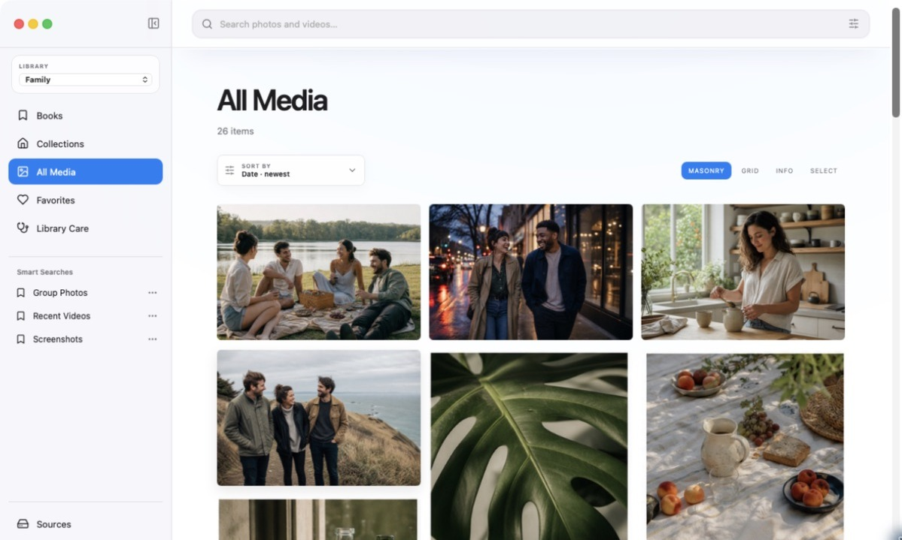
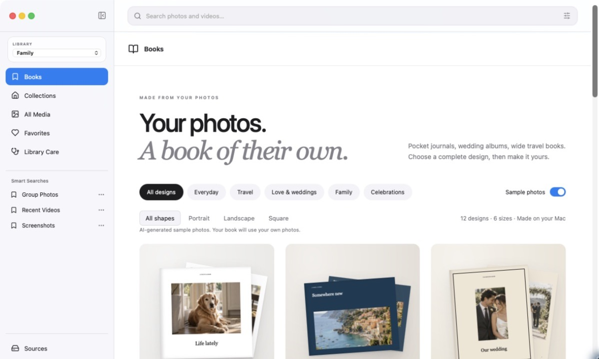
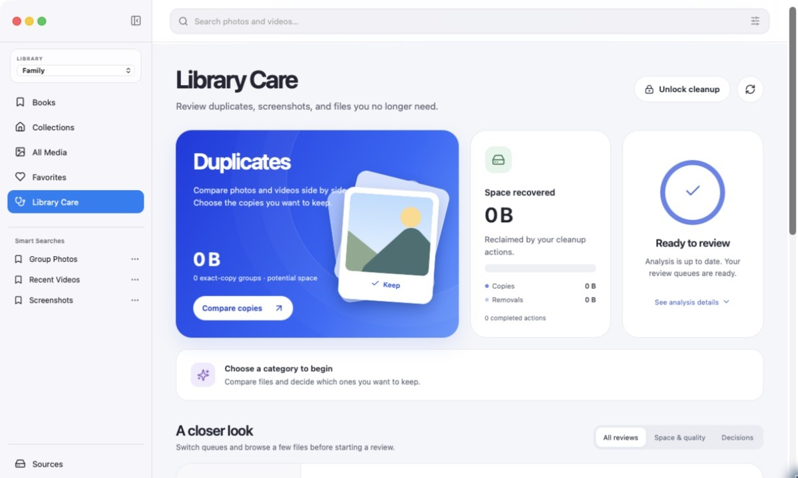

# Anthora

A free media library for folders on your Mac. Browse photos and videos, make photo books, export PDFs, and review cleanup suggestions. All features are free; no activation key or subscription is required.

[Website](https://barryanders.github.io/anthora/) · [Releases](https://github.com/barryanders/Anthora/releases) · [Issues](https://github.com/barryanders/Anthora/issues)

## Screenshots

Real app captures. [Explore the full-size showcase](https://barryanders.github.io/anthora/).







## Build

Requires macOS 14 or later, Apple silicon, Swift 6, Node.js, and Homebrew Python 3.14. The source contains the native app and workers, browser interface, and local service. It excludes private deployment configuration, catalogs, media, and model weights.

```sh
npm --prefix Web ci
npm --prefix Web run build
swift build -c release
Scripts/build-ffmpeg-helper.sh
Scripts/bundle-anthora.sh
```

The bundle script expects Homebrew Python 3.14 and its shared libraries. The optional face-embedding model is not included in this repository; the app builds without it. For model provenance and third-party licenses, see `Release/Customer/THIRD_PARTY_NOTICES.md`. Direct downloads are ad-hoc signed, not Apple-notarized.

## Verification

```sh
swift test
node --test Web/src/*.test.js
python3 -m unittest discover -s Service -p 'test_*.py'
```

## Privacy and data

Originals stay in their folders. Review cleanup decisions before applying them and maintain your own backups. Keep the local service bound to loopback; private-server deployment and public hosting are not part of this release. Never attach personal media or a library database to a public issue.

## License

Original project code is MIT licensed. Third-party components, fonts, and assets retain their own licenses and notices.

## Support

[Buy me a coffee](https://buymeacoffee.com/barryanders). Donations are optional and do not unlock features. There are no donation prompts in the app.
